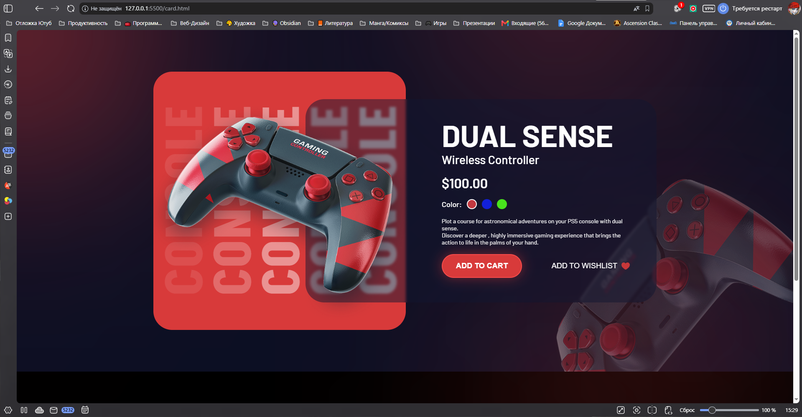

# Как это должно выглядеть

# Использованные ресурсы
Макет: https://www.figma.com/community/file/1589632298452902646/wireless-controller-product-card-ui

Проверка на БЭМ: https://tools.galsit.com/markup/bem.php
